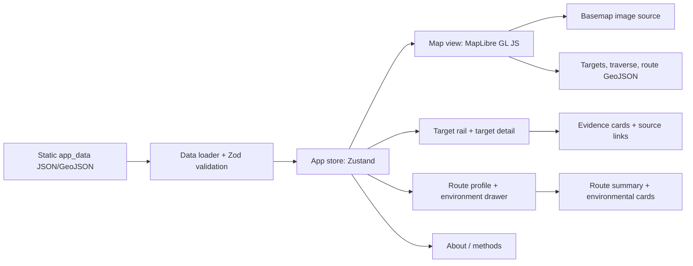

# 01 — System Architecture

## 1. Product boundary

**Product:** Jezero Expedition Intelligence (JEI)  
**Type:** Static, client-side web application. No backend, no database, no runtime NASA API calls.  
**Purpose:** A local-scale science evidence atlas and traverse planner for Jezero Crater. It helps a user answer:

1. Where are the documented science targets?
2. What is the evidence for each target, and how strong is it?
3. What are the competing explanations?
4. How do habitability, biosignature evidence, scientific value, and accessibility differ?
5. What would a traverse between these targets look like, and what assumptions does it make?

**Out of scope for this build:**

- Global Mars mapping.
- Arbitrary route optimization or pathfinding.
- Real-time weather or radiation feeds.
- Authentication, user accounts, or persistence.
- Sample-return planning or engineering-grade EVA certification.
- Any claim of confirmed Martian life.

## 2. Architecture at a glance



The application is a **single-page React app**. All scientific content is pre-generated static data in `public/data/`. The app reads it at startup, validates it, and renders. There are no server calls after the initial static asset load.

## 3. Recommended repository structure

```text
jezero-expedition-intelligence/
├─ public/
│  └─ data/
│     ├─ manifest.json
│     ├─ targets.geojson
│     ├─ traverse.geojson
│     ├─ route.geojson
│     ├─ route_profile.json
│     ├─ environment.json
│     ├─ evidence.json
│     ├─ sources.json
│     └─ basemap_jezero_1024.jpg
├─ src/
│  ├─ main.tsx
│  ├─ App.tsx
│  ├─ styles/
│  │  ├─ tokens.css
│  │  └─ globals.css
│  ├─ lib/
│  │  ├─ data.ts              # load + validate all data
│  │  ├─ schemas.ts           # Zod schemas for the JSON contracts
│  │  ├─ sort.ts              # objective-specific target sorting
│  │  ├─ format.ts            # coordinates, elevation, distance, sources
│  │  └─ constants.ts         # copy strings, labels, colors
│  ├─ store/
│  │  └─ useAppStore.ts       # selected target, objective, layer, route mode, drawer
│  ├─ components/
│  │  ├─ layout/
│  │  │  ├─ TopBar.tsx
│  │  │  ├─ StatusBar.tsx
│  │  │  ├─ LeftRail.tsx
│  │  │  └─ RightPanel.tsx
│  │  ├─ map/
│  │  │  ├─ MapView.tsx
│  │  │  ├─ mapStyle.ts
│  │  │  ├─ useMapLayers.ts
│  │  │  └─ MapLegend.tsx
│  │  ├─ targets/
│  │  │  ├─ TargetList.tsx
│  │  │  ├─ TargetListItem.tsx
│  │  │  ├─ TargetDetail.tsx
│  │  │  ├─ AssessmentChips.tsx
│  │  │  ├─ EvidenceCard.tsx
│  │  │  └─ SourceLink.tsx
│  │  ├─ route/
│  │  │  ├─ RoutePanel.tsx
│  │  │  └─ ElevationProfile.tsx
│  │  ├─ environment/
│  │  │  └─ EnvironmentDrawer.tsx
│  │  └─ common/
│  │     ├─ Badge.tsx
│  │     ├─ Drawer.tsx
│  │     ├─ Tooltip.tsx
│  │     ├─ EmptyState.tsx
│  │     └─ ErrorState.tsx
│  └─ test/
│     ├─ setup.ts
│     └─ *.test.tsx
├─ scripts/
│  ├─ copy-data.mjs           # copies app_data into public/data
│  └─ validate-data.mjs       # optional Node validation of JSON
├─ index.html
├─ package.json
├─ tsconfig.json
├─ vite.config.ts
├─ tailwind.config.ts
├─ postcss.config.js
├─ playwright.config.ts
└─ README.md
```

## 4. Data contracts

All data lives in `public/data/`. The app must treat it as **read-only**.

### 4.1 `manifest.json`

```ts
type Manifest = {
  schemaVersion: "1.0.0";
  app: { name: string; shortName: string; version: string };
  region: {
    name: string;
    bounds: [number, number, number, number]; // [west, south, east, north]
    center: [number, number];
    crs: string;
    note: string;
  };
  basemap: {
    kind: "usgs_hirise_browse";
    image: string;
    bounds: [number, number, number, number];
    alignment: "approximate" | "verified";
    resolution_m: number;
    source: string;
    sourceUrl: string;
    fullResolution: { url: string; pixel_m: number; size: string };
    warning: string;
  };
  layers: Array<{ id: string; name: string; kind: string; default: boolean }>;
  targets: string;
  traverse: string;
  route: string;
  routeProfile: string;
  environment: string;
  evidence: string;
  sources: string;
};
```

### 4.2 `targets.geojson`

`FeatureCollection<Point>` with `coordinates: [lon, lat, elevation_m]`.

```ts
type TargetProperties = {
  id: string;                 // "T1" … "T9"
  code: string;               // display code
  name: string;
  elevation_m: number;
  unit: string;
  context: string;
  summary: string;
  habitability: "High" | "Moderate" | "Low" | "Unknown" | string;
  biosignature: "Potential" | "Weak" | "None documented" | "Unknown" | string;
  science: "High" | "Moderate" | "Low" | "Unknown" | string;
  access: "Easy" | "Moderate" | "Difficult" | "Unknown" | string;
  confidence: "High" | "Moderate" | "Low" | "Moderate–Low" | "Low–Moderate" | string;
  confidence_reason: string;
  source_ids: string[];
  distance_from_landing_km: number;
  nearest_rover_sol: number;
  coordinate_note: string;
};
```

The strings intentionally allow compound values such as `"Low–Moderate"` and `"Potential (highest documented, not confirmed)"`. Do not coerce them to a single enum or a number.

### 4.3 `traverse.geojson`

`FeatureCollection<LineString>` with `coordinates: [lon, lat, elevation_m][]`. Properties include `distance_km`, `elevation_min_m`, `elevation_max_m`, `sols`, `source`, `note`.

### 4.4 `route.geojson`

`FeatureCollection<LineString>` for the fixed route `R1`.

```ts
type RouteProperties = {
  id: "R1";
  name: string;
  kind: "rover_traverse_segment";
  start_target: "T1";
  end_target: "T7";
  waypoints: string[];
  distance_km: number;
  ascent_m: number;
  descent_m: number;
  max_grade_pct: number;
  min_grade_pct: number;
  dem_source: string;
  note: string;
};
```

### 4.5 `route_profile.json`

```ts
type RouteProfile = {
  route_id: "R1";
  summary: {
    distance_km: number;
    ascent_m: number;
    descent_m: number;
    max_grade_pct: number;
    min_grade_pct: number;
    elevation_min_m: number;
    elevation_max_m: number;
  };
  profile: Array<{
    distance_km: number;
    elevation_m: number;
    lat: number;
    lon: number;
    sol: number;
  }>;
  assumptions: string[];
};
```

### 4.6 `environment.json`

```ts
type EnvironmentItem = {
  id: string;
  domain: "Radiation" | "Atmosphere" | "Terrain" | "Water ice" | "Mobility";
  kind: "measured" | "analogue" | "model" | "unknown" | "assumption";
  headline: string;
  detail: string;
  source_ids: string[];
  confidence: string;
  display: string;
};
```

### 4.7 `evidence.json`

```ts
type EvidenceRecord = {
  id: string;
  target_id: string;
  claim: string;
  class:
    | "observation"
    | "interpretation"
    | "hypothesis"
    | "public interpretation"
    | "counter-evidence";
  instrument: string;
  source_ids: string[];
  confidence: string;
  supports: string[];
  counter_evidence: string;
  what_would_change: string;
};
```

### 4.8 `sources.json`

```ts
type Source = {
  id: string;       // "P1", "P4", "D1", "U1", "M1"
  citation: string;
  url: string;
  type: "paper" | "data" | "map" | "model" | "public";
};
```

## 5. Data loading and validation

At startup, `src/lib/data.ts` must:

1. Fetch `manifest.json`.
2. Fetch every file referenced by the manifest.
3. Parse JSON and GeoJSON.
4. Validate with Zod schemas in `src/lib/schemas.ts`.
5. Expose a typed `AppData` object to the app.
6. If any fetch fails, render a full-screen `ErrorState` with the file name and a retry button.
7. If validation fails, log the failing path in development and render a readable error, not a blank screen.

**Rule:** do not silently substitute invented data. A missing file is an error state, not a reason to fabricate.

## 6. State management

Use Zustand with a single store:

```ts
type Objective = "geological" | "habitability" | "biosignature" | "accessibility";

type AppState = {
  objective: Objective;
  selectedTargetId: string | null;
  hoveredTargetId: string | null;
  routeMode: boolean;
  environmentOpen: boolean;
  aboutOpen: boolean;
  layers: {
    basemap: boolean;
    traverse: boolean;
    route: boolean;
    targets: boolean;
  };
  selectTarget: (id: string | null) => void;
  setObjective: (o: Objective) => void;
  toggleRoute: () => void;
  toggleLayer: (id: keyof AppState["layers"]) => void;
  openEnvironment: (open: boolean) => void;
  openAbout: (open: boolean) => void;
};
```

Selection is by `selectedTargetId`; the map, left rail, and right panel all read from it. Do not duplicate selection state in components.

## 7. Map architecture

Use **MapLibre GL JS** with a local image source for the basemap and GeoJSON sources for overlays.

### 7.1 Map initialization

```ts
const map = new maplibregl.Map({
  container,
  style: {
    version: 8,
    sources: {
      basemap: {
        type: "image",
        url: "/data/basemap_jezero_1024.jpg",
        coordinates: [
          [77.22, 18.55], // top-left
          [77.58, 18.55], // top-right
          [77.58, 18.35], // bottom-right
          [77.22, 18.35]  // bottom-left
        ]
      },
      targets: { type: "geojson", data: "/data/targets.geojson" },
      traverse: { type: "geojson", data: "/data/traverse.geojson" },
      route: { type: "geojson", data: "/data/route.geojson" }
    },
    layers: [
      { id: "background", type: "background", paint: { "background-color": "#0B0F14" } },
      { id: "basemap", type: "raster", source: "basemap", paint: { "raster-opacity": 0.9 } }
    ]
  },
  bounds: [77.22, 18.405, 77.48, 18.515],
  fitBoundsOptions: { padding: 40 },
  maxBounds: [77.18, 18.38, 77.52, 18.54],
  minZoom: 9,
  maxZoom: 13,
  attributionControl: false
});
```

**Important:** the basemap alignment is approximate. The status bar must show:

> `Basemap: USGS HiRISE browse · approximate alignment`

and the basemap tooltip must link to the full-resolution product. Do not present the browse image as a measurement-grade basemap.

### 7.2 Layers

| Layer | Type | Default | Notes |
|---|---|---|---|
| `basemap` | raster image | on | USGS HiRISE browse; approximate alignment |
| `traverse` | line | on | dashed, muted cyan; rover daily track |
| `route` | line | off | amber, 3 px; visible in route mode |
| `targets` | circle + symbol | on | target markers and codes |
| `targets-selected` | circle | on | selection ring |
| `targets-labels` | symbol | on | target codes; hide labels only below zoom 9.5 |

Do **not** add a slope raster or CRISM raster layer unless the actual raster data is added to `public/data/` and the manifest. The provided package has no slope or mineral raster. A disabled “Slope” toggle with a “data not loaded” tooltip is acceptable; a fake raster is not.

### 7.3 Interaction

- Click a target circle → `selectTarget(id)`.
- Hover a target → `hoveredTargetId`; show a cursor and a tooltip with name + four one-word assessments.
- Click the map background → clear selection.
- Selected target → `flyTo` with a short duration (≤ 600 ms) and a zoom of 13.
- Route mode → fit bounds to the route with padding; show the route line and the bottom profile.
- Layer toggles → `setLayoutProperty` visibility; do not rebuild the map.

### 7.4 Accessibility alternative

The map is not the only way to access the data. The left rail is a fully keyboard-navigable list of targets. Selecting a list item selects the map target. The detail panel contains all information in text. This satisfies the “map is not the only interface” rule.

## 8. Component responsibilities

| Component | Responsibility |
|---|---|
| `App.tsx` | Load data, render shell, handle global error/loading |
| `TopBar.tsx` | Brand, objective selector, route toggle, environment button, about button |
| `LeftRail.tsx` | Search, objective sort label, target list, legend |
| `MapView.tsx` | MapLibre instance, layers, selection sync |
| `RightPanel.tsx` | Target detail or route summary or empty state |
| `TargetDetail.tsx` | Header, assessment chips, tabs, evidence list, sources |
| `AssessmentChips.tsx` | Four separate assessment chips with tooltips |
| `EvidenceCard.tsx` | Claim, class badge, instrument, confidence, source, counter-evidence |
| `RoutePanel.tsx` | Route summary, assumptions, elevation profile |
| `ElevationProfile.tsx` | Accessible SVG line chart with hover/focus points |
| `EnvironmentDrawer.tsx` | Five environment cards with kind badges |
| `StatusBar.tsx` | CRS, basemap alignment, resolution, “not a safety certification” |
| `AboutDrawer.tsx` | Methods, sources, limitations, no-life statement |

## 9. Error, loading, and empty states

- **Loading:** skeleton shell with the top bar and a “Loading Jezero data…” message. Do not show a blank map.
- **Fetch error:** full-screen card with the missing file, a retry button, and a link to `README.md`.
- **Validation error:** card with the JSON path and the expected type; in development, print to console.
- **No selection:** right panel shows a “Select a target” state with a short explanation of the four assessments.
- **No route:** route panel shows a “Route data not loaded” state; do not draw a fake line.
- **No environment data:** drawer shows “Environmental data not loaded.”

## 10. Performance budgets

| Metric | Budget |
|---|---|
| Initial JS (gzip) | ≤ 350 KB (MapLibre is the largest dependency) |
| Initial CSS (gzip) | ≤ 30 KB |
| Data payload | ≤ 1.5 MB total (the provided data is ~250 KB + 114 KB basemap) |
| First contentful paint (local) | ≤ 1.5 s |
| Map interaction | 60 fps pan/zoom on a 2020-era laptop |
| Route profile render | ≤ 16 ms for 120 points |

Do not add heavy charting, 3D globe, or video libraries. The elevation profile is a small custom SVG.

## 11. Security and privacy

- No API keys, tokens, or secrets.
- No analytics, cookies, or tracking.
- Source links open with `target="_blank" rel="noopener noreferrer"`.
- All data is local and public; no user input is persisted.
- If a search field is added, it filters local strings only; no network calls.

## 12. Build and deployment

- Vite static build: `pnpm build` → `dist/`.
- The app must work when served from a subpath. Set `base: "./"` in `vite.config.ts` or document the base path.
- Deploy `dist/` to Vercel, Netlify, GitHub Pages, or any static host.
- No server-side rendering.
- The app must run at `http://localhost:5173` with `pnpm dev`.

## 13. Definition of architectural done

The architecture is done when:

1. `pnpm build` succeeds with no TypeScript errors.
2. The app loads all data from `public/data/` and renders the map.
3. Selecting a target in the list or on the map updates the detail panel.
4. The four assessments are visible and separate.
5. Route mode renders the fixed route and elevation profile.
6. The basemap alignment warning and “not a safety certification” copy are visible.
7. The app works at 1440×900, 1280×800, and 390×844.
8. No text claims confirmed life.

